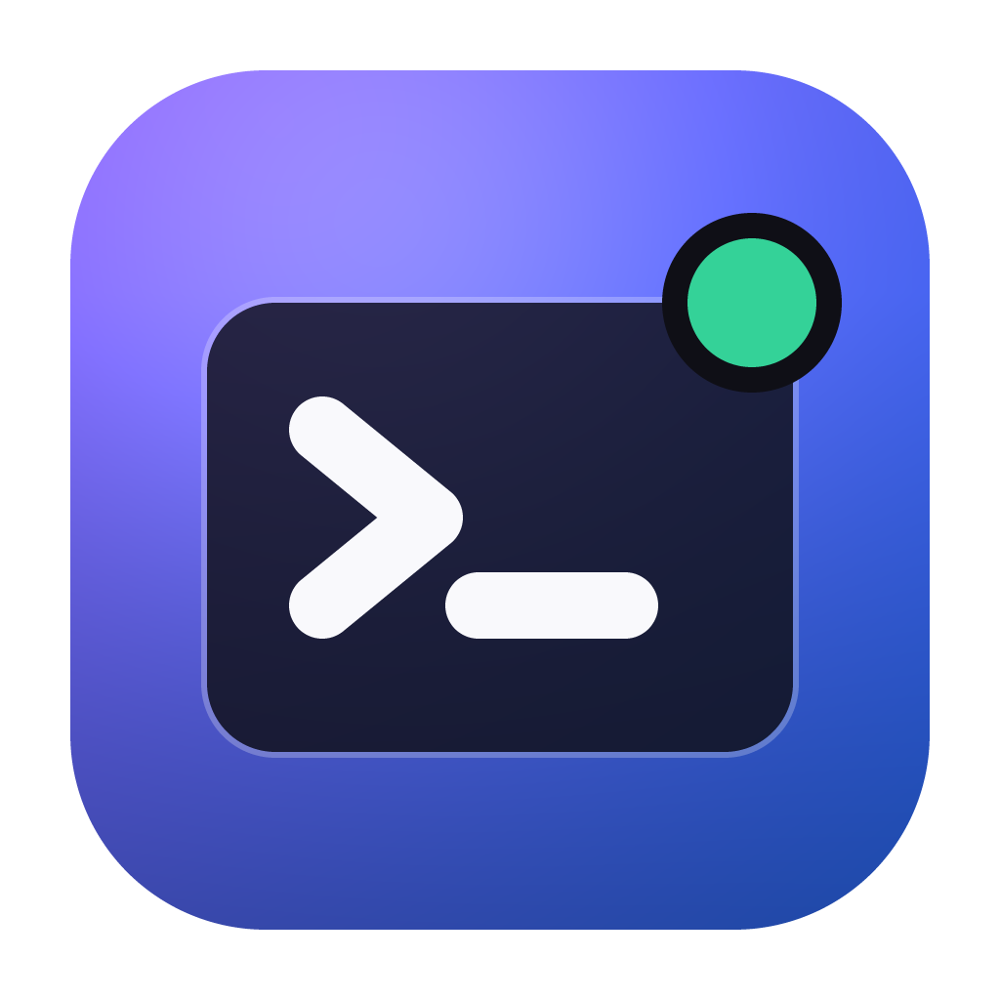
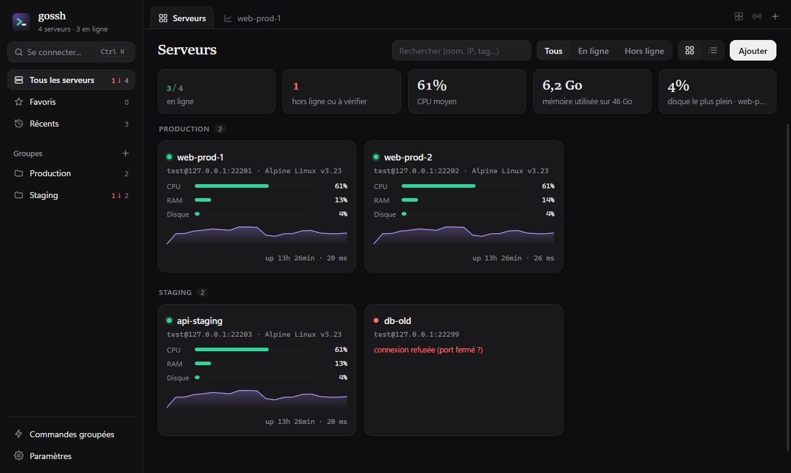
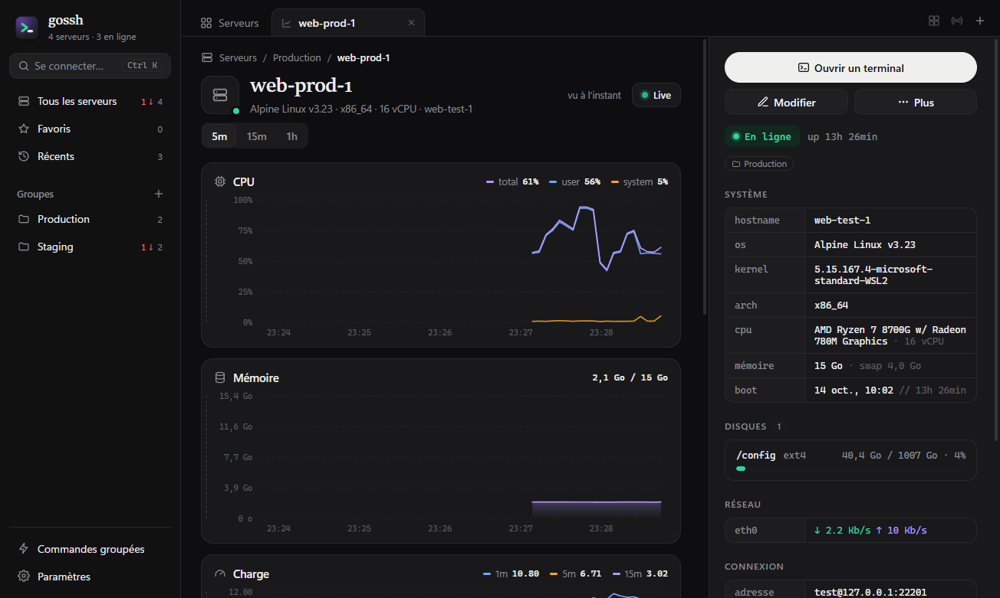
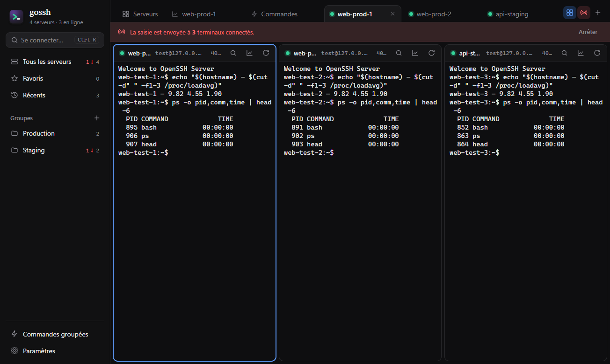
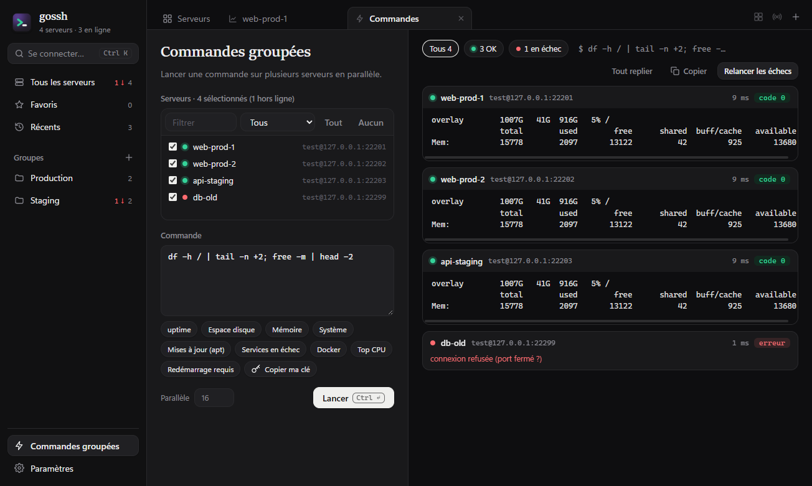
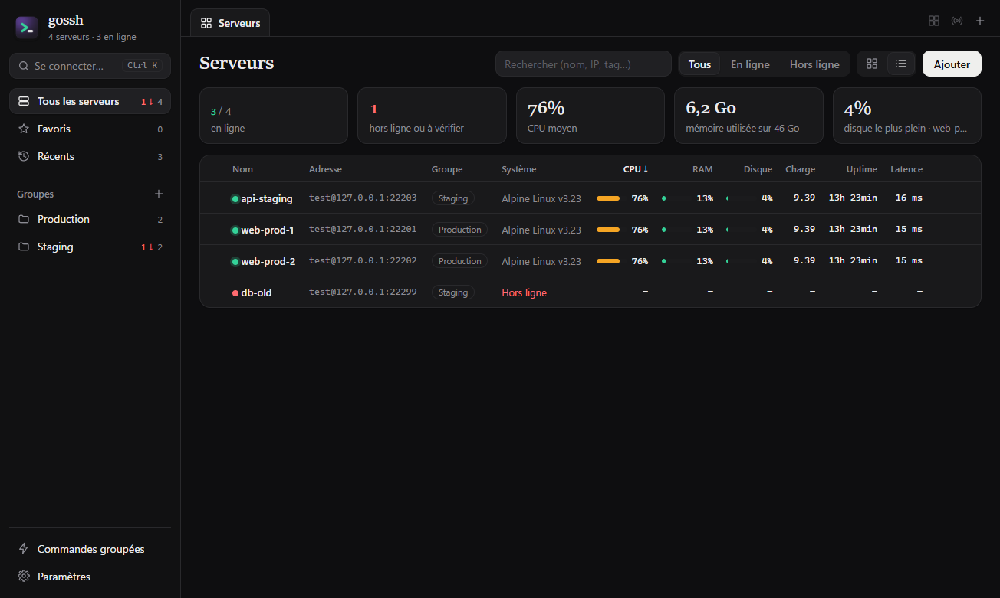

<p align="center"></p>

<h1 align="center">gossh</h1>

<p align="center"><b>Gérer ses serveurs SSH en lot, depuis une seule fenêtre.</b><br/>
Inventaire, terminaux en onglets, statistiques en direct et commandes sur des dizaines de serveurs à la fois.</p>

<p align="center"></p>

gossh est une application de bureau installable (Windows, et aussi macOS et Linux) faite avec
[MyGo](https://github.com/egoist/mygo) : un seul exécutable Go de quelques mégaoctets, l'interface
dans le WebView2 de Windows, sans Electron ni Node à l'exécution. Elle reprend le standard de
développement et l'interface de [xdll](../xdll).

## Ce qu'elle fait

**Un inventaire de serveurs**
- Ajout un par un, **en lot** (coller une liste `user@hôte:port nom`), ou **import de `~/.ssh/config`** (avec `ProxyJump`) et d'un export gossh.
- Groupes (glisser des serveurs sur un groupe), tags, couleurs, favoris, notes, récents.
- Authentification par clé privée, agent SSH (OpenSSH de Windows ou `SSH_AUTH_SOCK`), clés par défaut de `~/.ssh` ou mot de passe — chiffré avec DPAPI sous Windows.
- Serveurs de rebond (ProxyJump), en chaîne.
- Vérification des clés d'hôtes : empreinte à approuver à la première connexion (une par une ou **toutes d'un coup**), alerte si la clé change. Les clés de `~/.ssh/known_hosts` sont reconnues.

**Des terminaux en onglets**
- Autant de terminaux que voulu, sur un ou plusieurs serveurs, dans des onglets que l'on réordonne.
- **Mosaïque** : tous les terminaux côte à côte.
- **Diffusion de la saisie** : ce qui est tapé part dans tous les terminaux ouverts (à la cluster-ssh).
- xterm.js complet : couleurs 24 bits, liens cliquables, recherche, copier/coller (clic droit), taille de police, reconnexion.

**Des statistiques en direct, sans agent**
- CPU (total, user, system), mémoire et swap, charge, réseau, E/S disque, disques montés, uptime, latence.
- Lues par SSH dans `/proc` toutes les 5 s (réglable) : rien à installer sur les serveurs.
- Vue d'ensemble de la flotte, cartes avec jauges et courbe, vue liste triable, page détaillée avec graphiques sur 5 min, 15 min ou 1 h.

**Des commandes groupées**
- Une commande lancée sur tous les serveurs choisis en parallèle, les sorties en direct serveur par serveur, codes de retour, durée.
- Filtres OK / en échec, relancer les échecs, copier toutes les sorties.
- Commandes prêtes (espace disque, mémoire, services en échec, mises à jour, Docker…) et **copie d'une clé publique** dans `authorized_keys` de tous les serveurs.

| | |
|---|---|
|  |  |
|  |  |

## Installer

Télécharger `gossh Setup x.y.z.exe` depuis les [releases](https://github.com/Sutsikii/go-ssh/releases)
et le lancer. `go tool mygo build` le construit aussi en local, dans `build/windows-amd64/`.
Les données sont dans `%APPDATA%\gossh` :

| Fichier | Contenu |
|---|---|
| `servers.json` | les serveurs, groupes et mots de passe chiffrés (DPAPI) |
| `known_hosts` | les clés d'hôtes approuvées dans gossh |
| `settings.json` | intervalle des statistiques, thème |

L'app se met à jour toute seule depuis les [releases GitHub](https://github.com/Sutsikii/go-ssh/releases) :
une vérification par jour, avec une fenêtre qui propose d'installer. Dans Paramètres : vérifier
maintenant, désactiver la vérification, ou installer sans demander.

## Raccourcis

| Touche | Action |
|---|---|
| Ctrl K, Ctrl T | Se connecter à un serveur (recherche) ; Maj+Entrée ouvre ses statistiques |
| Ctrl Maj W | Fermer l'onglet |
| Ctrl Tab, Ctrl Maj Tab | Onglet suivant, précédent |
| Ctrl 1…9 | Aller à l'onglet |
| Ctrl Maj M | Mosaïque des terminaux |
| Ctrl Maj B | Diffuser la saisie à tous les terminaux |
| Ctrl Maj F | Rechercher dans le terminal |
| Ctrl Maj C, Ctrl Maj V | Copier, coller (ou clic droit) |
| Ctrl + / Ctrl − / Ctrl 0 | Taille du texte du terminal |
| Ctrl , | Paramètres |
| Liste : Ctrl A, Entrée, Suppr, Échap | Tout sélectionner, ouvrir les terminaux, supprimer, désélectionner |

Dans un terminal, les raccourcis à une touche (Ctrl K, Ctrl W…) restent au shell : utiliser leur version avec Maj.

## Développer

Il faut Go 1.27 ou plus. Voir [docs/development.md](docs/development.md).

```sh
go tool mygo dev     # lancer en développement, rechargé à chaque modification
go tool mygo build   # build/windows-amd64/gossh.exe et l'installateur
go test ./...        # dont un serveur SSH en mémoire (clés, rebond, terminal, commandes, stats)
```

## Documentation

- [Présentation et guide d'utilisation](docs/guide.md)
- [Architecture](docs/architecture.md)
- [Développement](docs/development.md)

## Licence

MIT
